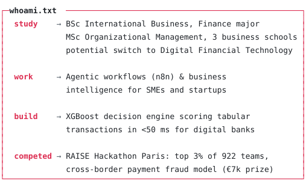
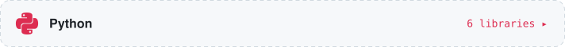
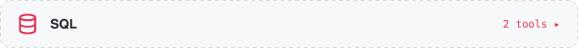
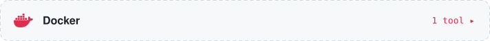
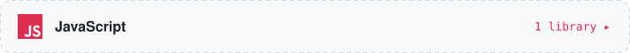
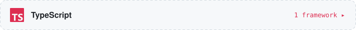
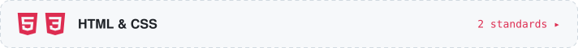

<picture>
  <source media="(prefers-color-scheme: dark)" srcset="art/header-dark.svg">
  
</picture>

<table align="center">
<tr>
<td width="62%" valign="top">

</td>
<td width="38%" align="center" valign="middle">

</td>
</tr>
</table>

  

<picture></picture>

<picture></picture>

<picture></picture>

<picture></picture>

<picture></picture>

<picture></picture>

<!-- PROJECTS:START -->

  

open source: &nbsp;<a href="https://github.com/Petraisalex/portfolio-recommendation-engine">portfolio-recommendation-engine</a>

<!-- PROJECTS:END -->

  
  

  

  

  
  &nbsp;
  
  &nbsp;
  

Collecting the next hobby. See you in the next commit.

